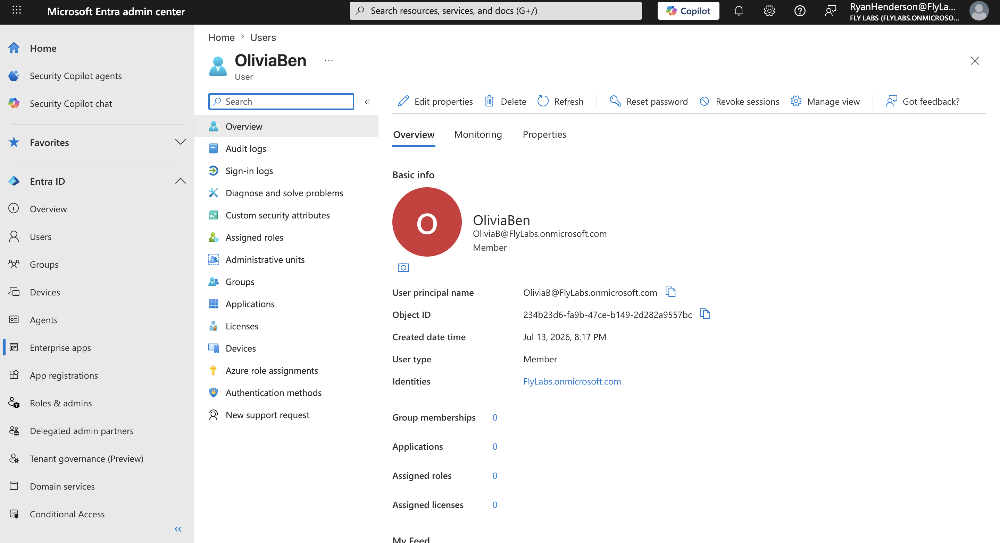
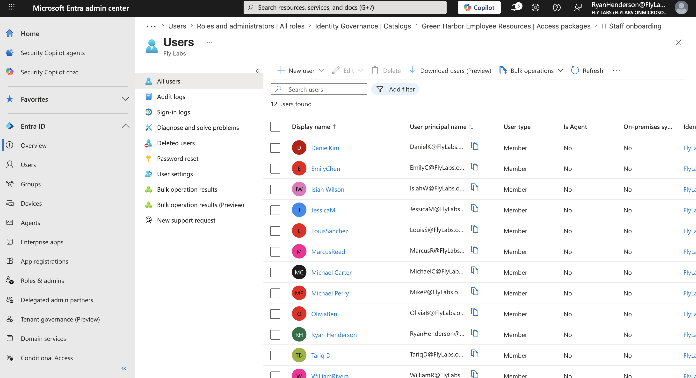
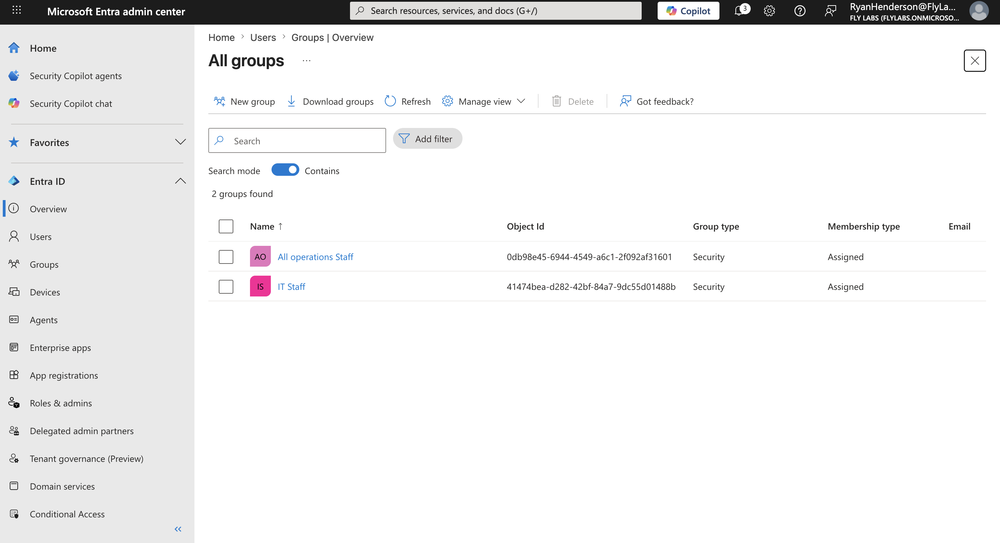
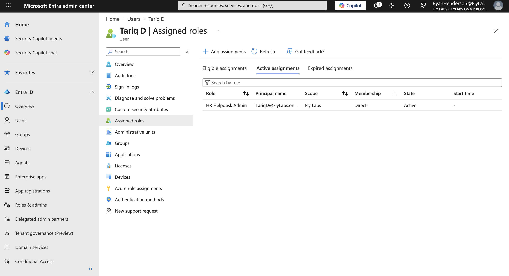
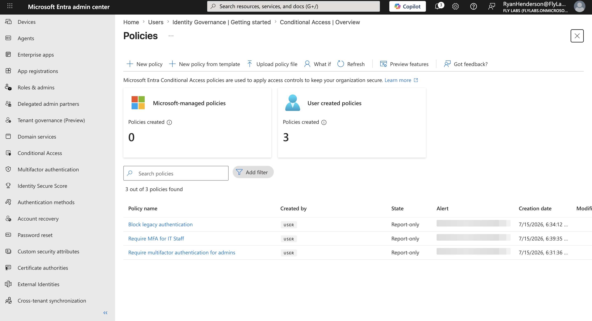
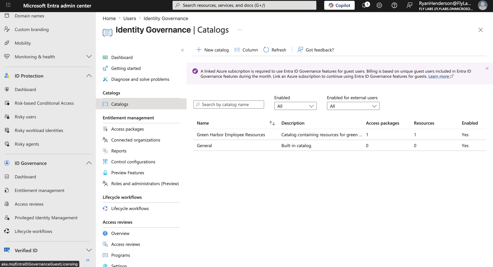
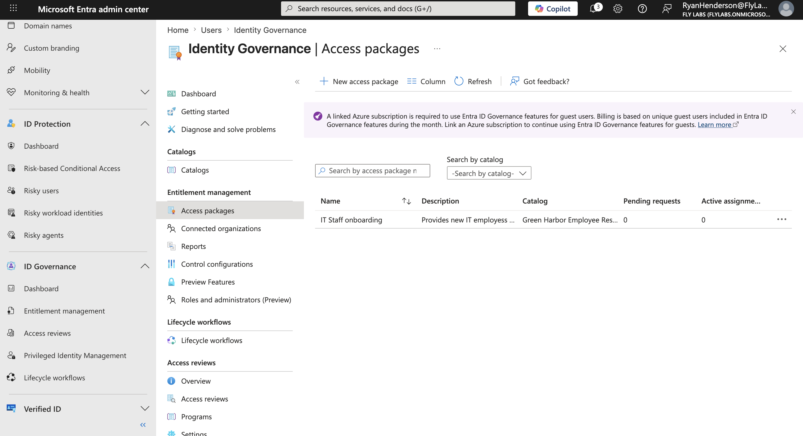
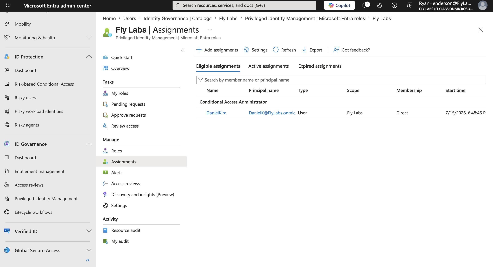
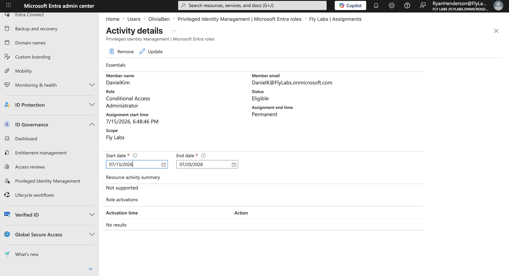
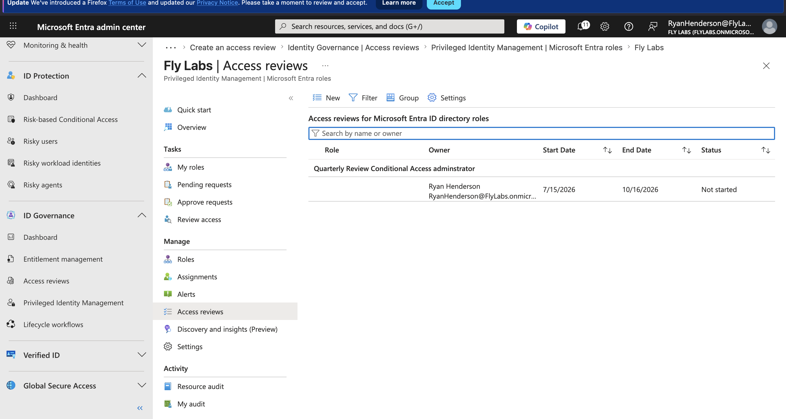

Green-harbor.md

# Green Harbor Sanitation IAM Portfolio. 

## About this project
Hi, I’m Ryan Henderson, and I’m building my career in identity and access management. I built this project to take what I’ve learned through study and certs and labs and put it into a real-world style company setup. 
To me, IAM is about making sure the right people have the right access at the right time, while keeping that access secure. It’s not just creating accounts. It’s the full lifecycle.

## CEO Olivia Bennett. 

## User Creation

I created fictional user accounts across Green Harbors Executive, HR, IT, Finance, and Operations departments to practice setting up identities in a way that mirrors a real company. Each user has a specific role and place in the org chart, including manager relationships. That gives me a base to assign groups, roles, apps, and security controls later on.

## Security Groups

I created security groups based on departments and job responsibilities within Green Harbor Sanitation. Instead of managing access user by user, these groups let me organize people by what they need for their jobs, and then use those groups when assigning apps or policies. To me, security groups are about making access easier to manage, while still keeping it controlled. If a bunch of people need the same access, I don’t have to click each person individually. I manage a group and adjust membership as roles change. This helps me apply least privilege in a practical way by making sure users are only added to groups that provide the access they need.

## Application Developer role assignment 

I assigned the application developer role to Lewis Sanchez because his responsibilities involved managing application registrations in Entra ID. Instead of giving him a broader admin role with permissions he didn’t need, I chose a role that matched his actual duties. To me, role assignments are about balancing access with responsibility, so that people can do their jobs without opening unnecessary risk.

## Custom HR Role

For this lab, I created a custom HR role instead of using a broad built-in admin role. I scoped it just to the permissions that HR typically needs, password resets, and group membership management. That way, HR staff can do their job without having unnecessary access. To me, building a custom role like this is about putting least privilege into practice, not just talking about it.

## Policies

Configured multiple conditional access policies to strengthen identity security. Blocked legacy authentication protocols in report-only mode. Required MFA for members of the IT staff group, and required MFA for administrators, which together protect accounts and organizational resources by enforcing modern authentication and role-based controls. To me, conditional access is about defining the rules for how and when access is allowed. MFA adds a second check, blocking legacy auth closes common bypasses, and using report-only mode helps me see the impact before enforcing. That showed me securing access isn’t just flipping switches, it’s balancing protection with usability.

## Identity Governance 

I set up the Green Harbor Employee Resources catalog, then created an IT staff onboarding access package to group those resources together. That way, new IT employees can request what they need, but it still goes through an approval step. To me, that’s what governance is about. Building a controlled process for who can request access, who approves it, and what they get. I used Eligible assignments so elevated access is temporary and approved. To me, that’s about reducing standing privileges and lowering risk. To me, that’s about reducing standing privileges and lowering risk. I set a quarterly review so elevated roles don’t linger forever. To me, reviews are a checkpoint, making sure access still makes sense as roles change.

## Privileged Identity Management (PIM)

Assigned the Conditional Access Administrator role to Daniel Kim. This allows him to create and manage conditional access policies without granting broader admin permissions. Also, updated Daniel Kim’s role assignment from active to eligible using Microsoft Entra Privileged Identity Management. This enables just in time access, so he activates the role only when he needs to perform admin tasks. To me, using PIM is about limiting standing admin rights. By switching Daniel Kim from permanently active to eligible, It means elevated access is time bound and approved when needed, rather than always on.

## Access Review

Created a quarterly access review for users eligible for the Conditional Access Administrator role, ensuring privileged access is periodically validated and unnecessary permissions are removed.

## Joiner Mover Leaver

Previously, we demonstrated the Joiner phase by provisioning a new user and assigning baseline access in Entra ID. This section continues that lifecycle, covering access changes during role transitions and secure off-boarding, to reinforce least privilege and reduce risk.

Mover, Jessica Morgan, Operations to HR.

Scenario: Jessica Morgan transferred from Operations to HR. Objective. To align access with her new role following least privilege. Actions: Reviewed existing group membership, updated group memberships to reflect HR alignment, verified and captured screenshots. Outcome: Successfully demonstrated a role transition with updated access.

**Before: Jessica's Original Operations Group Membership

**After: Jessica's New Human Resources group Membership

This project demonstrates the implementation of a secure IAM environment using Microsoft Entra ID for the fictional Green Harbor Sanitation. It includes user and group management, RBAC, custom roles, conditional access policies, identity governance with catalogs and access packages, privileged identity management, and access reviews, all aligned to least privilege and Zero Trust principles. This hands-on project demonstrates the ability to design, implement, and document core Microsoft Entra ID IAM solutions applying best practices for enterprise environments.

